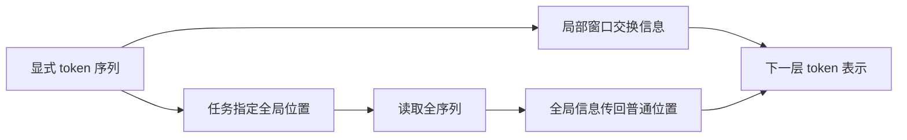

# Longformer：保留 token，用局部与全局连接控制长文成本

> [!abstract] 核心理解
> Longformer 改的是序列中哪些 token 能互相注意：多数 token 看局部窗口，少量任务指定的全局 token 连接全序列。它保留显式 token 表示，不把全部历史压成一个固定大小的递归状态。本文的直接证据来自字符语言建模、文档理解与摘要，不是长期交互 Agent 的完整任务成功率。[[raw/papers/optimization/architecture/Longformer.pdf#page=3|S032 · §3.1 · pp.3–4]] [[raw/papers/optimization/architecture/Longformer.pdf#page=7|§6 · pp.7–9]] [[raw/papers/optimization/architecture/Longformer.pdf#page=9|§7 · pp.9–10]]

## 身份与读取边界

| 项目 | 记录 |
| --- | --- |
| 标题 | Longformer: The Long-Document Transformer |
| 作者 | Iz Beltagy、Matthew E. Peters、Arman Cohan |
| 版本 | arXiv:2004.05150v2，2020-12-02；本地 PDF 共 17 页 |
| 原始来源 | [arXiv 版本页](https://arxiv.org/abs/2004.05150v2)；[本次 PDF](https://arxiv.org/pdf/2004.05150v2)，访问 2026-10-25 |
| 原件 | [[raw/papers/optimization/architecture/Longformer.pdf\|Longformer.pdf]] |
| SHA-256 | `053756B54E2D3462D4690B3AED489C962F17DF7C3531865E47374C4A651F526C` |
| 读取日期与范围 | 2026-10-25；正文 PDF pp.1–10，补读附录 pp.15–17；未逐条核读参考文献与 p.14 附录内容；不是实验复现 |
| 图表核验 | 实际渲染并查看 p.3 Fig.2 注意力图、p.4 Eq.1 与机制说明、p.9 Table 10 消融及 LED 说明 |
| 综述来源 | [[wiki/surveys/Towards Long-Horizon Agents\|S001]]，ref.[32]，§5.1.1 PDF p.38；参考文献 p.78 |
| 整合状态 | 已整合至 [[wiki/optimization/architecture\|Optimization 架构基础]]；内容与结构已验收，应用未测 |

## 困难究竟在何处

全自注意力需要比较序列中的所有 token 对，随输入长度产生二次成本。文章处理的是“单份输入很长、证据分散于文档”的问题，而不是跨任务复用经验或环境连续变化。局部窗口削减每层连接数，但远距离依赖可能需要穿过多层才能传递；全局连接为任务关键位置提供较短的信息路径。[[raw/papers/optimization/architecture/Longformer.pdf#page=1|S032 · §1 · pp.1–2]] [[raw/papers/optimization/architecture/Longformer.pdf#page=3|§3.1 · pp.3–4、Fig.2]]

## 一层怎样处理信息

| 连接 | 如何运行 | 代价与边界 |
| --- | --- | --- |
| 局部窗口 | 每个 token 关注附近固定宽度窗口，叠层扩大感受野 | 固定窗口宽度 $w$ 时为 $O(nw)$；一层不能任意读取远处 token |
| 扩张窗口 | 在窗口采样中留间隔，以相同连接数扩大覆盖 | 用于本文字符语言建模；不能把它当作所有 Longformer 实验都启用的配置 |
| 全局注意力 | 选定位置关注所有 token，所有 token 也关注这些位置 | 分类使用特殊分类 token，QA 使用问题 token；线性长度成本依赖全局位置数量受控 |

上述关系来自 §3.1 与 Fig.2；局部/全局各自使用投影矩阵，仍按缩放点积注意力计算权重。全局 token 的选择是任务设计，不是文中证明的自主重要性发现机制。[[raw/papers/optimization/architecture/Longformer.pdf#page=3|S032 · §3.1 · pp.3–4、Fig.2、Eq.1]]

图表示单层中的信息连接，不表示时间上的记忆写入，也不是作者原图。全局双向连接与层叠局部连接共同改变可达性；没有额外的持久记忆库。[[raw/papers/optimization/architecture/Longformer.pdf#page=3|S032 · §3.1 · pp.3–4]]

从 RoBERTa 迁移时，作者把位置嵌入复制扩展至 4096，并继续 masked language model 预训练；该迁移实验采用非扩张窗口。不能将“替换稀疏连接”解释为完全不训练即可获得本文全部结果。[[raw/papers/optimization/architecture/Longformer.pdf#page=6|S032 · §5 · pp.6–7]]

## 实验能支持什么

**长文理解证据。** §6 在 WikiHop、TriviaQA、HotpotQA、OntoNotes、IMDB 与 Hyperpartisan 等任务上比较模型，指标与输入处理随任务变化。Longformer 与分段处理的 RoBERTa 比较支持该预训练与微调设置下利用较长输入的价值，但不能拆成“仅延长上下文就必然提高表现”的因果结论。HotpotQA 实际仍使用段落过滤，不能概括为完全取消检索与筛选。[[raw/papers/optimization/architecture/Longformer.pdf#page=7|S032 · §6 · pp.7–9]] [[raw/papers/optimization/architecture/Longformer.pdf#page=15|附录 · pp.15–16]]

**WikiHop 消融。** Table 10 的 base 模型、5 epochs 条件下，4096 长度 Longformer 的 dev accuracy 为 73.8，2048 长度为 73.1；去掉额外 MLM 训练为 73.2。去掉全局专用投影为 72.2，而同时去掉该投影与全局注意力为 65.5。最后一项有两个改变，不能将 73.8→65.5 全部归于单独移除全局连接；表中 15 epochs 结果也不能当作同预算对照。[[raw/papers/optimization/architecture/Longformer.pdf#page=9|S032 · §6.5 · Table 10 · p.9]]

**生成版本 LED。** LED 在 encoder 使用 Longformer 注意力，decoder 保留全自注意力与对 encoder 的 cross-attention，以 BART 初始化后评估 arXiv 长文摘要。这里“输入长度线性扩展”的讨论不等于所有生成计算都成为线性，也不等于已经验证长期工具调用与错误恢复。[[raw/papers/optimization/architecture/Longformer.pdf#page=9|S032 · §7 · pp.9–10、Fig.4、Table 11]]

字符语言建模实验检验的是 text8/enwik8 上的 bits-per-character；其扩张连接、分阶段训练长度与下游 RoBERTa 迁移配置不同，不能把这些配置或指标混在一起。[[raw/papers/optimization/architecture/Longformer.pdf#page=5|S032 · §4 · pp.5–6]]

## 成立前提、比较与未解决内容

- **前提：**局部性足以承担大量相互作用，任务能够给出少量全局位置，且有适当的预训练/微调适配。增加全局 token 数量会增加成本；固定窗口与有限全局位置是效率解释的组成部分。[[raw/papers/optimization/architecture/Longformer.pdf#page=3|S032 · §3.1 · pp.3–4]]
- **最近工作：**作者在 §2 比较其他稀疏、分段、循环与压缩注意力方法；这些被引原论文未在本页对应阅读中逐篇核验，相关优劣只属于作者的背景比较。[[raw/papers/optimization/architecture/Longformer.pdf#page=2|S032 · §2 · pp.2–3]]
- **本库判断：**本篇提供“显式历史 + 稀疏访问”的机制证据。是否适用于会改变任务状态的 Agent 轨迹，需要另行考察关键信息的定位、时间顺序及行动闭环；本文文档任务不能回答这些问题。
- **待检验问题：**如果任务关键状态不位于预先指定的全局位置，哪些信息会因局部访问路径而难以使用？这是从机制提出的阅读问题，尚未查新，不是已确认研究缺口。

## 主题联系

相关主题为 [[wiki/optimization/architecture|Optimization：Architecture Design / explicit memory]]。已整合显式 token、稀疏连接与全局位置三者的关系，以及文档任务证据与 Agent 交互证据的边界；内容与结构已验收。Obsidian 应用渲染与跳转未测。

## 分类与阅读入口

主归属与交叉方向：[[wiki/optimization/architecture|optimization/architecture]]。
