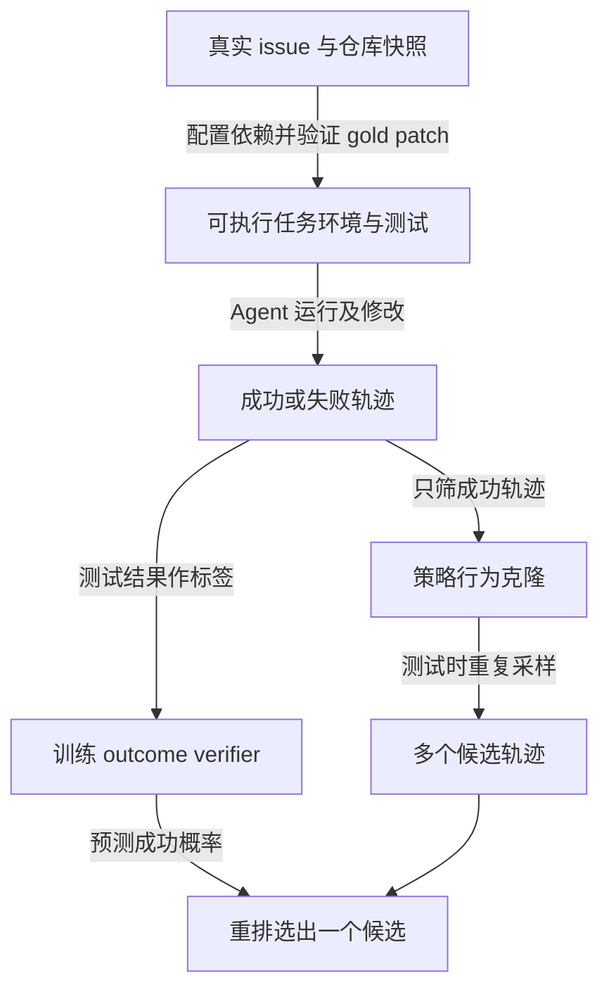

# Training Software Engineering Agents and Verifiers with SWE-Gym

## 来源与阅读范围

| 项目 | 记录 |
| --- | --- |
| 来源 ID | S038 |
| 作者 | Jiayi Pan、Xingyao Wang、Graham Neubig、Navdeep Jaitly、Heng Ji、Alane Suhr、Yizhe Zhang |
| 版本 | ICML 2025 正式 PMLR 267 版本；proceedings PDF 21 页 |
| 原始入口 | [SWE-Gym](https://proceedings.mlr.press/v267/pan25g.html)；访问日期 2026-10-25 |
| 原件 | [[raw/papers/optimization/data-environments/SWE-Gym.pdf\|本地 PDF，共 21 页]] |
| SHA-256 | `5AEFA26959CB5230FD054CBE66B33E653AC80BC31DF25CE910C2F3C29BCC504E` |
| 实际阅读 | 2026-10-25；正文 pp.1–9；附录 A、B.1–B.4 与训练数据/预算表 pp.13–16；看 p.4 Table 2/Fig.2、p.6 Table 3–4、p.7 Fig.3。附录后续 verifier 提示和补充曲线未逐项核读。 |
| S001 定位 | 引文 467，§5.2.1; 5.2.2，PDF p.41,42；书目 p.113 |

以下为原论文直接证据与明确标注的本库分析；未复现实验。页码均为本地 PDF 自首页起算。

## 核心理解：环境给出测试标签，标签再用于训练策略和验证器

SWE-Gym 的主要贡献是将真实 GitHub issue、对应代码快照、可执行依赖环境和测试放在一起，使 Agent 可以真正修改仓库并收到执行反馈；它不是让 LLM 凭空写出一套代码世界。任务需要定位、编辑、运行与迭代，错误修改会影响后续测试和修复。作者构建 2,438 个任务、11 个 Python 仓库，并与 SWE-Bench 仓库分离；SWE-Gym Raw 的 64,689 条 issue 不全有可执行环境，不能都计作可训练的执行样本。[[raw/papers/optimization/data-environments/SWE-Gym.pdf#page=3|§3–3.1 · pp.3–4]]

图为本库机制示意。环境测试的结果与 verifier 预测分属两个层次：训练用真实测试产生标签，部署时由学习到的模型预测候选成功率，预测并不保证通过测试。[[raw/papers/optimization/data-environments/SWE-Gym.pdf#page=5|§4.1–4.2 · p.5]]、[[raw/papers/optimization/data-environments/SWE-Gym.pdf#page=7|§5.1.1 · p.7]]

## 构造与筛选的代价

依赖配置是半手工流程，按版本复用配置；论文报告约 200 人工小时、10,000 CPU core hours 与 6 TB Docker 镜像，不能将其概括为零成本自动环境合成。验证要求 human gold patch 比初始代码通过更多测试，过滤设置失败实例；测试覆盖仍不是任意软件正确性的证明。Lite 230 个任务进一步排除多文件修改、描述不清、复杂补丁等，天然改变难度分布。[[raw/papers/optimization/data-environments/SWE-Gym.pdf#page=4|§3.1–3.3 · p.4]]

**本库推断：**人工配置减少“仅保留容易安装项目”的偏差，但最终 11 个流行 Python 仓库、仓库长尾以及成功轨迹筛选仍限定分布；本文不能证明真实软件任务的全面代表性。作者也将语言、任务和仓库多样性列为局限。[[raw/papers/optimization/data-environments/SWE-Gym.pdf#page=9|§6 · p.9]]

## 哪些训练收益已经得到支持

| 设定 | 观察到的结果及边界 |
| --- | --- |
| OpenHands CodeAct 2.1；bash+file editor、禁用浏览器 | 491 条由 GPT-4o/Claude 3.5 Sonnet 采集的成功轨迹，Qwen2.5-Coder-Instruct 32B 在 SWE-Bench Verified 从 7.0% 到 20.6%，Lite 从 3.0% 到 15.3%；这是特定 scaffold 上的 teacher 轨迹 SFT |
| 同一 OpenHands 的自采样再训练 | 混合 868 条 on-policy 与既有 491 条 off-policy 后，Lite 从 15.3% 降到 8.7%；不能将所有自我训练说成有效 |
| MoatlessTools 的受限工作流 | 每任务 30 次、temperature=1 的 rejection sampling，两轮后 7B 从 7.0% 到 10.0%，32B 从 19.0% 到 19.7%；不同动作空间和训练设置不能与 OpenHands 当作单变量比较 |

直接证据：[[raw/papers/optimization/data-environments/SWE-Gym.pdf#page=5|§4.2 · pp.5–6]]、[[raw/papers/optimization/data-environments/SWE-Gym.pdf#page=6|§4.3、Table 3–4 · p.6]]。MoatlessTools 对每任务最多收 2 条成功轨迹且优先较少响应轮数，用于减少易题过度占据训练数据；cap 与样本总量同时变化，结果不是纯粹的多样性因果实验。[[raw/papers/optimization/data-environments/SWE-Gym.pdf#page=13|Appendix A、Table 6 · p.13]]

OpenHands 策略全参数训练最长 5 epochs、batch 8、context 32768，使用 2–8 张 H100 80G；测试至多 100 interaction turns 或 32k context，先到即止。采样教师轨迹时则有 30/50-turn 的不同预算，不应与测试 100-turn 混用。[[raw/papers/optimization/data-environments/SWE-Gym.pdf#page=13|Appendix B.2 · pp.13–15]]、[[raw/papers/optimization/data-environments/SWE-Gym.pdf#page=16|Table 10 · p.16]]

## 更多候选与选对候选是不同能力

32B OpenHands policy 配 32B verifier，SWE-Bench Verified 的 **Pass@16 为 42.8%，Best@16 为 32.0%**；后者才是 verifier 选出一个结果的成功率。首条 temperature=0，其余 0.5，不能把 16 次轨迹预算的结果当单次性能。verifier 以成功/失败平衡的 2,636 条轨迹训练，混合 on/off-policy，主结果采用 LoRA。[[raw/papers/optimization/data-environments/SWE-Gym.pdf#page=7|§5.1.1、Fig.3 · p.7]]、[[raw/papers/optimization/data-environments/SWE-Gym.pdf#page=15|Appendix B.2 · p.15]]

原文在 k=8 的图/正文有 29.3 与 29.8 等不一致，本文只摘录一致的 k=16 端点。p.5 自采样成功数 868 与 p.7 verifier 训练所述 875 亦不一致，保留各处口径，不以过滤脚注强行解释数目为何上升。证据足以说明 verifier 与数据分布影响选择，但尚不能说明某类失败一定来自奖励失真。

与并行工作 Lingma/SWE 环境博客的比较只属于作者附录 A 转述，未独立核读对方。后续最有价值的是在固定轨迹池中核查测试标签覆盖、verifier 误选类型和难题欠采样，而非直接把 32.0% 宣称通用软件可靠性。

## 主题联系与验收状态

已整合至 [[wiki/optimization/data-environments|数据与环境合成]]；同时整合至 [[wiki/optimization/finetuning|微调]]、[[wiki/harness/verification|Harness 验证]]。主题、索引、互链与摄入日志已同步；主 Agent 已完成内容与结构验收，Raw 哈希匹配。Obsidian 应用未测，未复现实验。

## 分类与阅读入口

主归属与交叉方向：[[wiki/optimization/data-environments|optimization/data-environments]] · [[wiki/harness/verification|harness/verification]] · [[wiki/optimization/finetuning|optimization/finetuning]]。
