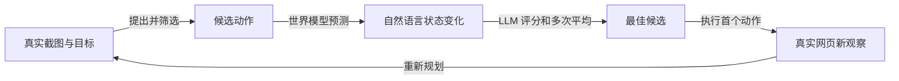

# Is Your LLM Secretly a World Model of the Internet? Model-Based Planning for Web Agents

## 来源与阅读范围

| 项目 | 记录 |
| --- | --- |
| 来源 ID | S039 |
| 作者 | Yu Gu、Kai Zhang、Yuting Ning、Boyuan Zheng、Boyu Gou、Tianci Xue、Cheng Chang、Sanjari Srivastava、Yanan Xie、Peng Qi、Huan Sun、Yu Su |
| 版本 | arXiv:2411.06559v2，2025-04-01；本地页眉为 Preprint. Under review；未与 S001 所引 TMLR 正式版本逐项对齐 |
| 原始入口 | [WebDreamer](https://arxiv.org/abs/2411.06559)；访问日期 2026-10-25 |
| 原件 | [[raw/papers/optimization/data-environments/WebDreamer.pdf\|本地 PDF，共 22 页]] |
| SHA-256 | `ED7E9CD6629BFB30086153D3B6B02F91E1D576AB8F6D07F0AD5B9B4D9EBDCF33` |
| 实际阅读 | 2026-10-25；正文 pp.1–10；附录 B–E pp.14–22（提示、合成与训练、intrinsic evaluation、成败案例）；实际查看 p.4 方法图/Algorithm 1、p.7 Tables 1–2/Fig.4、p.8 Fig.5–6。参考文献未逐条核读。 |
| S001 定位 | 引文 188，§5.2.2，PDF p.42；书目 p.90 |

以下为原论文直接证据与明确标注的本库分析；未复现实验。页码均为本地 PDF 自首页起算。

## 核心理解：想象下一步，执行后仍回到真实观察

WebDreamer 面对的是网页操作不能任意回滚的问题。真实树搜索需要重置网站并重放路径；提交订单等操作难以撤销。它在执行前生成候选动作，过滤明显无关候选，用世界模型预测每个动作的页面变化，再用评分模型判断是否接近目标；只执行最佳候选的首个真实动作，随后以新截图重新规划。[[raw/papers/optimization/data-environments/WebDreamer.pdf#page=3|§3.1 · p.3]]、[[raw/papers/optimization/data-environments/WebDreamer.pdf#page=4|§3.2、Fig.2/Algorithm 1 · pp.4–5]]

本库示意中的“预测”是文本化状态差异，不是一个保证可交互、可恢复的完整网页模拟器；评分值也不是环境真实成功奖励。框架可模拟 H 步，但最终主实验取 **H=1**，因为更深模拟出现不可用动作幻觉和误差累积。不能据名称把它写成已经实现准确的长期网页 rollout。[[raw/papers/optimization/data-environments/WebDreamer.pdf#page=4|§3.2 · pp.4–5]]、[[raw/papers/optimization/data-environments/WebDreamer.pdf#page=8|§5.1、Fig.5 · p.8]]

## Dreamer-7B 的训练数据从哪里来

作者从 Common Crawl 2024-10 URL 出发做真实网页随机交互，采集动作前后截图，再让 Qwen2-VL-72B 写出元素描述和变化描述。Dreamer-7B 由 Qwen2-VL-7B-Instruct 训练，输入当前截图与动作，预测上述自然语言变化；它没有在此流程中学一个端到端任务策略或真实奖励函数。数据共 3,160,247 个交互、约 125 万 URL，84% 是 click，另有 hover/type/select；失败交互、阻止自动化内容被过滤，scroll 因下游贡献小而排除。[[raw/papers/optimization/data-environments/WebDreamer.pdf#page=5|§3.3、Fig.3 · pp.5–6]]、[[raw/papers/optimization/data-environments/WebDreamer.pdf#page=18|Appendix C.2、Table C.2 · p.18]]

**本库推断：**真实执行保证动作前后截图有环境依据，但将截图翻译成文字仍会引入教师遗漏/幻觉；过滤失败交互及点击占比又限制训练分布。数据来自多步序列的中间位置不等于模型已经掌握更长模拟深度，训练目标仍主要为单步变化。训练用 64 张 H100 80G，最多 2 epochs、batch 192；每 1,000 steps 用 intrinsic evaluation 选 checkpoint。[[raw/papers/optimization/data-environments/WebDreamer.pdf#page=18|Appendix C.2–C.3 · pp.18–19]]

## 实证支持及预算边界

作者在 VWA 的 233 个人工核验任务、Online-Mind2Web 抽取的 100 任务（30 easy/40 medium/30 hard）以及 Mind2Web-Live 104 任务上评测；前者是自托管沙盒，后两者实际在线网站。Online-Mind2Web 使用自动评价，作者引用其与人工 85% 一致率；Mind2Web-Live 按全部关键节点完成判成功，判据不同，不能直接横向排难度。[[raw/papers/optimization/data-environments/WebDreamer.pdf#page=6|§4.1 · p.6]]

| 结果 | 适用解释 |
| --- | --- |
| GPT-4o WebDreamer：VWA 23.6%、Online-Mind2Web 37.0%、Mind2Web-Live 25.0%；reactive 为 17.6/26.0/20.2 | 支持该实现下执行前模拟有帮助；不是全部网页可靠性或不可逆动作安全保证 |
| Dreamer-7B 作世界模型：21.9/35.0/24.0 | 小模型替换的是世界模型组件；score 仍用 GPT-4o，不能称整个 7B Agent 独立达到 GPT-4o 效果 |
| VWA tree search 26.2%；WebDreamer 约快 4–5 倍 | 同 GPT-4o 的 VWA wall-clock 比较，WebDreamer 仍比 reactive 慢；真实网站没有可比 tree-search 实验 |
| H=1/2/3：Online-Mind2Web 37/32/32 | 更长想象没有单调收益；作者将下降归因模拟动作幻觉，尚非对所有任务的因果定律 |

证据：[[raw/papers/optimization/data-environments/WebDreamer.pdf#page=7|§4.2、Tables 1–2 · p.7]]、[[raw/papers/optimization/data-environments/WebDreamer.pdf#page=8|§5.1、Fig.5 · p.8]]。Table 1 的 VWA GPT-4o 23.6 与 Table 3 的 Total 23.2 存内部差异，本文标明使用 Table 1，不静默合并。具体候选 k、每候选模拟/评分次数和总 token 预算，本次所读正文/附录未确认，4–5 倍不作为通用成本保证。

Intrinsic evaluation 用已知正确动作与失败轨迹偏离动作比较，并通过同一 score 函数排序，平分也算正确；其 state-level accuracy 用于选 checkpoint。因此它测量的是“预测能否帮助排序”，并非逐项验证页面转移真实性。失败轨迹里的动作也未必本身不可挽回，这是本库推断的负例标签边界。[[raw/papers/optimization/data-environments/WebDreamer.pdf#page=19|Appendix D.1–D.3 · pp.19–20]]

## 当前认识变化

本篇把“环境合成”细化成用于决策的状态差异预测：可以从真实截图采集监督，又在测试时用不真实执行的模拟节省探索。最需要保留的是世界模型、value scorer 与真实环境三个反馈来源的区别。与作者提及其他 world-model agent 的新颖性比较尚未独立核验；候选问题是如何在固定候选与评分预算下区分转移误差和评分误差，当前仅为待核查问题，未完成查新。

## 主题联系与验收状态

已整合至 [[wiki/optimization/data-environments|数据与环境合成]]；同时整合至 [[wiki/optimization/finetuning|模型组件训练]]、[[wiki/harness/workflows#分支能否撤回，评价能否被信任|Harness 执行前模拟]]。主题、索引、互链与摄入日志已同步；主 Agent 已完成内容与结构验收，Raw 哈希匹配。Obsidian 应用未测，未复现实验。

## 分类与阅读入口

主归属与交叉方向：[[wiki/optimization/data-environments|optimization/data-environments]] · [[wiki/optimization/finetuning|optimization/finetuning]]。
