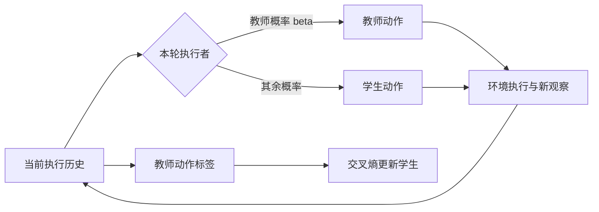

# Revisiting DAgger in the Era of LLM-Agents

## 来源身份与读取范围

| 项目 | 记录 |
| --- | --- |
| 来源 ID | S057 |
| 作者 | Changhao Li、Rushi Qiang、Jiawei Huang、Chenxiao Gao、Chao Zhang、Niao He、Bo Dai |
| 版本 | arXiv:2605.12913v1；预印本；正式发表状态未确认 |
| 原始页面 | [arXiv版本页](https://arxiv.org/abs/2605.12913v1)；[版本PDF](https://arxiv.org/pdf/2605.12913v1)；访问2026-10-25 |
| DOI | 10.48550/arXiv.2605.12913（arXiv标识） |
| 原件 | [[raw/papers/optimization/distillation/DAgger-LLM.pdf\|本地PDF · 22页]] |
| SHA-256 | `696B094377FF7C4628854A4D7708AD2935F3FA0938DE53EEAFB327F8D97EBEE4` |
| S001引用 | 引文309；§5.6.1，PDF pp.52,53；书目p.101 |
| 读取日期与范围 | 2026-10-25；正文pp.1–9；附录A–B（pp.14–16）、E–F（pp.17–18）；G提示/工具接口（pp.18–22）用于确认harness。看图核对p.4 Eqs.8–13、p.7 Table 3、p.17实际混合调度。未复现实验，参考文献未逐项核验。 |

## 核心理解：执行动作与训练标签可以来自不同策略

**原文陈述。** 多轮软件Agent的早期错误会改变仓库状态和后续观察。仅模仿成功教师轨迹覆盖不到学生部署时遇到的状态；完全学生rollout又可能早早陷入无效区域。本文在每轮决定由教师还是学生执行，但**每个访问状态都查询教师动作作标签**，以交叉熵训练学生。标签只需教师生成文本，因此方法接口可接黑盒教师；实验实际教师为Qwen3-Coder-30B-A3B-Instruct。[[raw/papers/optimization/distillation/DAgger-LLM.pdf#page=2|§1–2 · pp.2–3]] [[raw/papers/optimization/distillation/DAgger-LLM.pdf#page=4|§3.2、Eqs.8–13 · pp.4–5]] [[raw/papers/optimization/distillation/DAgger-LLM.pdf#page=6|§4.1 · p.6]]

本库机制示意，箭头为执行/监督信息流。教师标签不等于每次都由教师实际接管；执行轨迹才决定下一轮环境状态。依据 [[raw/papers/optimization/distillation/DAgger-LLM.pdf#page=5|Algorithm 1 · p.5]]。

DAgger-style逐轮独立抛硬币；AggreVaTe-style先让学生走κ轮，教师完成余段。监督动作内部的token前缀来自教师标签，因此它是**混合环境状态＋教师动作token监督**，不同于在学生原动作token上匹配教师logits。作者所谓dense在这里指多位置监督，不能当作独立核验的步骤因果奖励。[[raw/papers/optimization/distillation/DAgger-LLM.pdf#page=4|§3.2 · p.4]] [[raw/papers/optimization/distillation/DAgger-LLM.pdf#page=14|附录A · pp.14–16]]

> [!important] 方法描述与实际调度要分开
> 正文说β逐渐趋向0，但实际附录F.1采用 $\beta_i=\max(0.6,1-0.2(i-1))$，五轮训练后仍有60%教师执行概率。故本文实证支持教师较多介入的混合采集，不证明完全学生环境分布下的效果。附录称使用新批次更新；经典DAgger背景中的全历史数据聚合，不应自动补作本实现细节。[[raw/papers/optimization/distillation/DAgger-LLM.pdf#page=3|§2 · p.3]] [[raw/papers/optimization/distillation/DAgger-LLM.pdf#page=17|F.1–F.2 · pp.17–18]]

## 任务、结果和比较条件

OpenHands提供终端、文件编辑与finish接口；训练/测试上限100次环境交互、64K上下文。SWE-Gym 2,338训练任务与100 holdout；4B与8B Qwen3学生；每轮512条，5轮，每批3 epochs。DAgger/OPD只保留有效patch提交，SFT则保留测试通过的684条教师轨迹；过滤标准不同也会改变状态覆盖。[[raw/papers/optimization/distillation/DAgger-LLM.pdf#page=6|§4.1 · p.6]] [[raw/papers/optimization/distillation/DAgger-LLM.pdf#page=17|E–F、Table 5 · pp.17–18]] [[raw/papers/optimization/distillation/DAgger-LLM.pdf#page=21|G.2 · p.21]]

Table 3中4B与8B DAgger在作者SWE-bench Verified子集上的解决率分别27.3%、29.8%，对应OPD为23.4%、26.2%。**分母是466而不是500**：34个Matplotlib任务因Docker构建失败被排除。表内文献系统可能使用不同数据、harness和完整评测集，不能据跨系统分数认定参数效率优越。[[raw/papers/optimization/distillation/DAgger-LLM.pdf#page=6|§4.1脚注 · p.6]] [[raw/papers/optimization/distillation/DAgger-LLM.pdf#page=7|Table 3 · p.7]]

GRPO在293任务SkyRL-v0子集、8采样/题上训练；与DAgger不同数据、过滤和学习率，故“优于RL”仅是本文具体基线结果。§4.3的匹配effective samples曲线明确排除GRPO；effective samples不是已匹配总token、教师推理成本或墙钟时间。[[raw/papers/optimization/distillation/DAgger-LLM.pdf#page=7|§4.3 · pp.7–8]] [[raw/papers/optimization/distillation/DAgger-LLM.pdf#page=18|F.2、Table 5 · p.18]]

## 机制证据的强度

作者在学生采样历史上计算师生reverse KL，观察DAgger较稳定，作为分布偏移减轻的代理。**本库限定：**它测的是已访问状态上的动作分布差异，不是直接计算环境占据分布距离，更不识别恢复动作的独立因果贡献。故保留“支持作者解释”，不写成完成因果证明。[[raw/papers/optimization/distillation/DAgger-LLM.pdf#page=8|§4.4、Figure 2 · p.8]]

失败类型由LLM judge判断；提交率以466为分母，细分失败比例在各自未解决子集中计算，不能把no-submission中的context overflow百分比当全任务失败率。作者局限也限定OpenHands软件工程域及教师质量/成本。[[raw/papers/optimization/distillation/DAgger-LLM.pdf#page=8|Table 4、§4.5 · pp.8–9]] [[raw/papers/optimization/distillation/DAgger-LLM.pdf#page=16|附录B · p.16]]

**本库综合。** 与GKD相比，本篇直接提供环境交互中的状态分布处理实例，也说明“执行谁的动作”与“用谁的token当标签”需要分栏。理论no-regret结论来自作者对经典文献的转述，本次未独立核验原定理前提，不能推广为神经网络实现保证。下一条有价值证据是统一教师调用预算和混合比例的消融；当前属于材料缺口，不认定研究空白。

## 主题联系与维护状态

已整合到 [[wiki/optimization/distillation|Optimization · OPD]]；当前已完成摄入，内容与结构已验收。原件存在与哈希已核对；Obsidian渲染、公式及跳转未测（本轮已停用Computer Use）。

返回 [[wiki/index|索引]]。

本轮跨模块整合：[[wiki/frontier/Overview#检查结果如何成为训练材料|Frontier · 检查结果如何成为训练材料]]。该处保存与其他已读来源的条件比较，不增加本文的实证支持范围。

## 分类与阅读入口

主归属与交叉方向：[[wiki/optimization/distillation|optimization/distillation]]。
