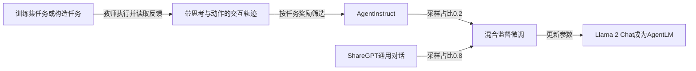

# AgentTuning: Enabling Generalized Agent Abilities for LLMs

## 来源与阅读范围

| 项目 | 记录 |
| --- | --- |
| 来源 ID | S047 |
| 作者 | Aohan Zeng、Mingdao Liu、Rui Lu、Bowen Wang、Xiao Liu、Yuxiao Dong、Jie Tang |
| 版本 | Findings of ACL 2024 正式版，pp.3053–3077；DOI 10.18653/v1/2024.findings-acl.181 |
| 原始入口 | [ACL Anthology](https://aclanthology.org/2024.findings-acl.181/)；访问 2026-10-25 |
| Raw | [[raw/papers/optimization/finetuning/AgentTuning.pdf\|本地 PDF，共25页]] |
| SHA-256 | `9b1cf0c9016c892802138af94496e9c11f11f7253a9603bc5963abe05e98ca9c` |
| 实际阅读 | 2026-10-25；正文及局限 PDF pp.1–9，附录 A–F pp.12–16；看 Fig.2 p.2、Eq.1 p.5、Table3 p.6、Fig.3/Table4 p.7、Table6/C.2 p.13 原页。构造/评测提示 pp.16–25 未逐条核读，参考文献未逐条核验。 |
| 综述定位 | S001 引文794，§5.4.1，PDF p.45；书目 p.139 |

以下为原论文直接证据和标明的本库分析；没有复现实验。PDF页码从首页算，印刷页码 = PDF页码 + 3052。

## 问题与方法：把可执行交互格式教给已有指令模型

这项工作的困难是：当时的 Llama 2 Chat 在互动环境中经常拒绝、产生无效动作或重复，普通语言任务表现不能保证它能连续使用环境反馈。作者用六类任务的教师交互数据训练模型，再混合通用对话，考察已见与未见任务类型。它主要给出多轮策略适应的证据，没有证明跨上下文持久状态或长期自主研究能力。[[raw/papers/optimization/finetuning/AgentTuning.pdf#page=2|§1、Fig.2 · PDF pp.2–3 / 印刷 pp.3054–3055]]

图为本库机制示意。训练输入保留指令和历史，损失只作用于模型输出；状态来自教师的历史轨迹，不是学生在训练中在线执行后产生的状态。主要教师为 GPT-4-0613，Mind2Web 因预算部分使用 GPT-3.5-turbo-0613；DB 的部分轨迹由参考 SQL 派生、再补思考，因此不能把全部思考都看成在线决策时的真实记录。[[raw/papers/optimization/finetuning/AgentTuning.pdf#page=4|§2.1.2 · PDF p.4 / 印刷 p.3056]]、[[raw/papers/optimization/finetuning/AgentTuning.pdf#page=5|§2.2.3 · PDF p.5 / 印刷 p.3057]]、[[raw/papers/optimization/finetuning/AgentTuning.pdf#page=13|Appendix E · PDF pp.13–14 / 印刷 pp.3065–3066]]

AgentInstruct 包含1,866条筛选轨迹，平均5.24轮；来自 ALFWorld、WebShop、Mind2Web、KG、OS、DB。大部分要求奖励1，Mind2Web 放宽至2/3；Mind2Web 用 teacher forcing 拆成单步，不能用其“轨迹”证明自主闭环导航。成功筛选改善数据质量，同时减少学生可能遇到的失败状态覆盖；后一点是本库机制分析。[[raw/papers/optimization/finetuning/AgentTuning.pdf#page=3|Table1 · PDF p.3 / 印刷 p.3055]]、[[raw/papers/optimization/finetuning/AgentTuning.pdf#page=4|§2.1.3、脚注1 · PDF pp.4–5 / 印刷 pp.3056–3057]]

## 哪些结论有实验支持

训练基于 Llama-2-7/13/70B-Chat，混合权重 η=0.2；ShareGPT 内 GPT-4/GPT-3.5 采样比1:4。主要评测六类 held-in、六类 held-out 任务与 MMLU、HumanEval、GSM8K、MT-Bench；各任务指标含成功率、奖励、F1和单步成功率，Overall 为加权归一化分数，不是统一成功率。历史超长会截断，多数任务贪心解码，WebArena 使用 top-p=0.9。[[raw/papers/optimization/finetuning/AgentTuning.pdf#page=5|§2.2–3.1 · PDF pp.5–6 / 印刷 pp.3057–3058]]、[[raw/papers/optimization/finetuning/AgentTuning.pdf#page=12|Table5 · PDF p.12 / 印刷 p.3064]]

| 支持的认识 | 不能升级的表述 |
| --- | --- |
| 混合训练明显改善已见 agent 任务；70B held-out Overall 从0.51变为1.40，接近该协议 GPT-3.5 的1.49 | 不是所有未见环境都可靠；70B WebArena仍为3.81，7B WebArena从1.23降到0.74 |
| 通用数据对防止退化有重要作用；Table4 的 agent-only 在未见任务和通用任务下降明显 | 混合轨迹的未见任务收益并非所有规模都独立成立；13B general-only 的0.81还高于混合0.78 |
| 通用能力总体接近，但各任务有升有降 | 不能写“完全无损”：Table3 13B General Overall 为0.74→0.69，70B MMLU 为62.1→59.5 |

证据：[[raw/papers/optimization/finetuning/AgentTuning.pdf#page=6|Table3 · PDF p.6 / 印刷 p.3058]]、[[raw/papers/optimization/finetuning/AgentTuning.pdf#page=7|§3.3–3.4、Table4、Fig.3 · PDF p.7 / 印刷 p.3059]]。错误分析支持无效动作/重复减少；“激活模型已有潜能”是作者解释，不是对内部机制的独立证明。

附录列 batch64、7/13B学习率5e-5、70B为1e-5等超参数；本次未确认完整训练总步数、总算力与教师生成成本，因此不据数据条数宣布总体廉价。[[raw/papers/optimization/finetuning/AgentTuning.pdf#page=15|Table10 · PDF p.15 / 印刷 p.3067]]

## 原文张力与局限

- 正文 p.5 称 η 在7B上按未见任务选择；附录 C.2 p.13 明确称只用 held-in/general，最终选13B最优0.2。两处不一致；本库保留最终使用0.2，但不确认调参完全未使用 held-out 信息。
- p.5 用“最小化”描述正 log-likelihood 之和，Eq.1 未写负号。应按监督最大似然理解目标意图，不能照抄为正确的最小化损失。
- 附录 F 的近似10-gram检测和作者人工解释不等于证明完全无污染；ALFWorld有6条、WebShop有1条超过其80%阈值，作者认为源于任务用词/结构重复。这里只确认检测结果与作者解释。

定位：[[raw/papers/optimization/finetuning/AgentTuning.pdf#page=5|§2.2.2、Eq.1 · PDF p.5 / 印刷 p.3057]]、[[raw/papers/optimization/finetuning/AgentTuning.pdf#page=13|Appendix C.2 · PDF p.13 / 印刷 p.3065]]、[[raw/papers/optimization/finetuning/AgentTuning.pdf#page=14|Appendix F、Tables11–12 · PDF pp.14–16 / 印刷 pp.3066–3068]]。作者另承认任务种类有限、依赖外部示范、未验证 Minecraft 等复杂任务。[[raw/papers/optimization/finetuning/AgentTuning.pdf#page=9|Limitations · PDF p.9 / 印刷 p.3061]]

## 当前知识的作用与验收

已整合至 [[wiki/optimization/finetuning|微调]]，提供“监督数据组成与通用能力保留”的直接证据；与 [[wiki/papers/optimization/finetuning/ATLAS|ATLAS]] 对照时应比较损失覆盖位置，而非跨基准分数。与 [[wiki/papers/optimization/reinforcement-learning/AgentGym-RL|AgentGym-RL]] 的差别在于这里用固定教师数据监督更新，而后者重新采集当前策略在线轨迹。其他相关工作的优劣与新颖性未因作者引用而获本库验证。

本库待检验问题：固定模型、任务与训练token后，混合通用数据的收益有多少来自防退化，有多少来自普通指令适应？当前只作为归因问题，未完成查新。

主题、索引、队列、互链与摄入日志已同步；主 Agent 内容与结构验收通过，Raw哈希匹配。Obsidian应用未测，未复现实验。

## 分类与阅读入口

主归属与交叉方向：[[wiki/optimization/finetuning|optimization/finetuning]]。
