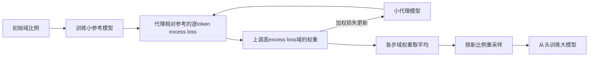

# DoReMi: Optimizing Data Mixtures Speeds Up Language Model Pretraining

**核心判断：**DoReMi 用小参考模型和小代理模型找数据域的采样比例，再从头训练更大模型。它传递的是数据权重，不是把代理模型直接蒸馏或作为最终模型；原实验是1024长度的一般语言模型预训练，不直接测长上下文或长程Agent。[[raw/papers/optimization/pretraining/DoReMi.pdf#page=2|Fig.1、§2 · pp.2–4]] [[raw/papers/optimization/pretraining/DoReMi.pdf#page=5|§3.1 · p.5]]

## 来源身份与阅读范围

| 项目 | 记录 |
| --- | --- |
| 来源 ID | S046 |
| 作者 | Sang Michael Xie、Hieu Pham、Xuanyi Dong、Nan Du、Hanxiao Liu、Yifeng Lu、Percy Liang、Quoc V. Le、Tengyu Ma、Adams Wei Yu |
| 版本 | NeurIPS 2023会议正式PDF；DOI未以本地PDF确认 |
| 原始渠道 | [原始发布页](https://papers.nips.cc/paper_files/paper/2023/hash/dcba6be91359358c2355cd920da3fcbd-Abstract-Conference.html)；[固定 PDF](https://papers.nips.cc/paper_files/paper/2023/file/dcba6be91359358c2355cd920da3fcbd-Paper-Conference.pdf)；访问 2026-10-25 |
| 本地原件 | [[raw/papers/optimization/pretraining/DoReMi.pdf\|DoReMi.pdf，共 21 页]] |
| SHA-256 | `6BF62C211048C07B786A2D9146E6FFAF38EF8AF744EEBDBE5281CDAF827227B4` |
| 阅读日期与范围 | 2026-10-25；主体 pp.1–10；附录 A–C pp.15–18及p.19模型配置/理论示例设置；看p.2 Fig.1–2、p.3 Eq.1、p.4 Algorithm1、p.8 Fig.6/Table3原页；理论附录D pp.19–21证明未完成逐步核验，参考文献未逐项读取 |
| S001 选择依据 | 引文 [715]，§5.3.4，PDF pp.44、45；参考文献 PDF p.133；正文角色和书目已回读核对 |

本页按本地 PDF 第一页起计页码。网页只用于身份核对，学术主张以已归档 PDF 为依据；未复现实验。原始下载文件为 `.research-tmp/S046-download.pdf`，归档前后字节与哈希一致。主题、索引、互链与摄入日志已同步；主 Agent 已完成内容与结构验收，Raw 哈希匹配。Obsidian 应用未测。

## 为什么优化“还值得学多少”，而非只追最难样本

原始token损失高可能来自噪声或不可预测性；很低则可能已容易学会。作者用代理与已训练参考模型的损失差表示可改进空间，以Group DRO最小化域间最坏excess loss。高差值意味着参考模型相对会做而代理还不会；这仍是依赖参考模型的学习代理量，不是真正已知的不可约熵。[[raw/papers/optimization/pretraining/DoReMi.pdf#page=3|§2、Eq.1 · p.3]]

本库重绘Algorithm1/Fig.1，箭头表示计算与更新，不代表直接转移参数。代理阶段均匀域采样minibatch，逐token的负excess loss截为0，再按域token数归一化；指数梯度更新域权重并平滑，代理使用加权目标。大模型阶段按平均权重重采样，采用普通训练。**代理阶段loss reweighting与大模型resampling不同**，也是作者解释代理模型质量不佳的一条假设。[[raw/papers/optimization/pretraining/DoReMi.pdf#page=4|Algorithm1、§2 · p.4]] [[raw/papers/optimization/pretraining/DoReMi.pdf#page=8|§4、Table3b · p.8]]

## 结果在什么预算和任务下成立

| 项目 | 本文具体条件 |
| --- | --- |
| 数据与模型 | The Pile / GLaM；decoder-only从头训练；核心280M参考+280M代理，权重用于8B主模型 |
| 训练预算 | batch512，最大长度1024；Pile 200k steps、GLaM 300k；权重搜索额外计算约为8B正式训练FLOPs的8% |
| 下游评价 | TriviaQA、NaturalQuestions、WebQuestions、SQuADv2、LAMBADA的one-shot生成exact match；另有域内验证困惑度 |
| 对照 | Pile默认启发式比例；GLaM用uniform作为基线，任务调好的oracle比例作为另一对照 |

这些配置来自[[raw/papers/optimization/pretraining/DoReMi.pdf#page=4|§3.1 · pp.4–5]]和[[raw/papers/optimization/pretraining/DoReMi.pdf#page=18|Appendix C · pp.18–19]]。原文GLaM正文称8 domains，但Table2只列6行，本页不自行补全缺失域名单。

Pile的280M→8B结果将5项平均EM由20.03升至26.56，约 **6.5个百分点**；约75k steps达到200k baseline质量，对应作者所称2.6×较少训练步数。它不是6.5%相对增幅，也不是含所有搜索开销的通用墙钟速度。280M参考/代理额外成本需保留，iterated DoReMi多轮也不能套单轮8%成本。[[raw/papers/optimization/pretraining/DoReMi.pdf#page=5|Fig.3、§3.1 · p.5]] [[raw/papers/optimization/pretraining/DoReMi.pdf#page=6|§3.2 · p.6]] [[raw/papers/optimization/pretraining/DoReMi.pdf#page=16|Appendix B、Table5 · p.16]]

## 消融带来的约束

**更大代理不保证更好。**固定8B主模型，70M→280M代理增大有益，但1B不继续改善；相同大小下DRO代理常弱于最终按比例重采样模型。作者提出优化器/训练方式差异解释，未把它证明为唯一原因。[[raw/papers/optimization/pretraining/DoReMi.pdf#page=8|§4、Fig.6、Table3 · p.8]]

**全域改善是特定设置的结果。**280M→8B在Pile所有22域困惑度都改善，甚至被降权的域；但同尺度模型系列平均改善18/22域，不能写所有配置都无权衡。作者的高/低熵域解释与附录简单unigram例子是解释性构造，未证明真实语料普遍满足。[[raw/papers/optimization/pretraining/DoReMi.pdf#page=6|§3.2 · p.6]] [[raw/papers/optimization/pretraining/DoReMi.pdf#page=7|§4 · p.7]] [[raw/papers/optimization/pretraining/DoReMi.pdf#page=16|Table6 · p.16]]

**相对难度比单边难度更合适是本文范围内结论。**Fig.6比较只追代理高损失（hardest）、只追参考低损失（easiest）与excess loss，后者更好；这不是对所有课程学习或样本选择方法的排除。域定义按来源，粗粒度控制、参考模型选择及跨规模迁移边界由作者列为局限。[[raw/papers/optimization/pretraining/DoReMi.pdf#page=8|§4、Fig.6 · p.8]] [[raw/papers/optimization/pretraining/DoReMi.pdf#page=10|§6 · p.10]]

## 对长程研究的含义

本库推断：若将来把任务族、轨迹阶段或恢复行为当“域”，先要解释参考/代理损失是否真的对应所需能力，以及小模型上的域偏好能否转移。本文没有做这些Agent实验；1024文本token的next-token loss不自动保留多步反馈、状态转移或最终成功信号。

与 [[wiki/papers/optimization/pretraining/ProLong|ProLong]] 的区别在优化目标：DoReMi不使用下游任务选择比例；ProLong显式用多类下游评测指导配方。在不同数据、模型和长度下两者不能直接排名。候选问题暂为“如何验证代理目标与长程任务目标的对应”，不是已确认未被研究的缺口。

## 本库落点与下一条证据

已整合到 [[wiki/optimization/pretraining|预训练与中期训练]]，主题与本页双向关联。相关方法的比较以本文实际实验为限，未核读的引用不成为独立来源。返回 [[wiki/index|索引]]。

## 分类与阅读入口

主归属与交叉方向：[[wiki/optimization/pretraining|optimization/pretraining]]。
