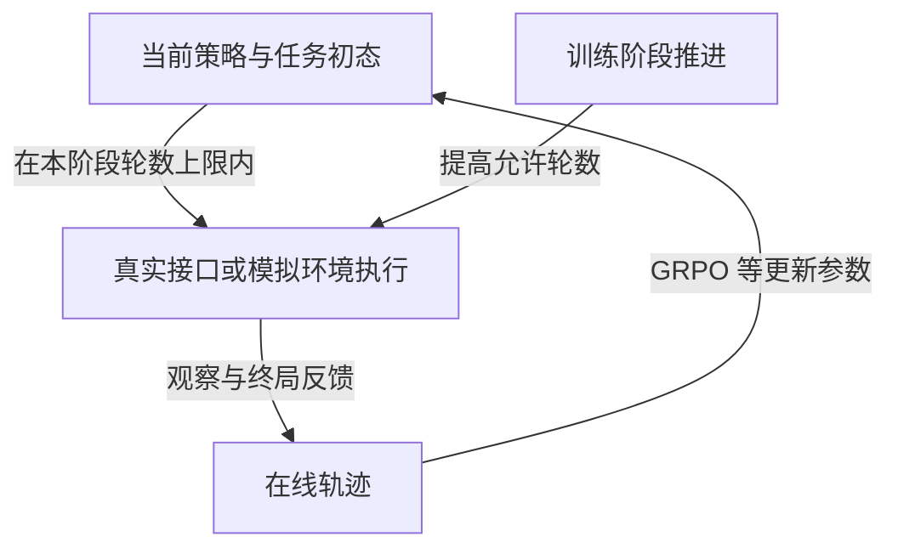

# AgentGym-RL: Training LLM Agents for Long-Horizon Decision Making through Multi-Turn Reinforcement Learning

## 来源与阅读范围

| 项目 | 记录 |
| --- | --- |
| 来源 ID | S041 |
| 作者 | Zhiheng Xi、Jixuan Huang、Chenyang Liao 等 23 人；完整作者见 PDF p.1 |
| 版本 | arXiv:2509.08755v1，2025-09-10 |
| 原始入口 | [AgentGym-RL](https://arxiv.org/abs/2509.08755)；访问日期 2026-10-25 |
| 原件 | [[raw/papers/optimization/reinforcement-learning/AgentGym-RL.pdf\|本地 PDF，共 39 页]] |
| SHA-256 | `E869AFB36921F859C85D8044CEDC3785CFBA16E677C5D366CE63F531D73927E5` |
| 实际阅读 | 2026-10-25；正文 pp.1–21；附录 A/B pp.31–34（接口、环境划分、奖励交互、训练设置）；看 p.5 Fig.3、p.9 课程公式、p.12 Fig.7/Table1、p.16 Table5、p.32 WebArena设置。附录 C pp.35–39 的逐条案例未完整核读，引用文献未逐条核读。 |
| S001 定位 | 引文 701，§5.2.3，PDF p.43；书目 p.132 |

以下为原论文直接证据与明确标注的本库分析；未复现实验。页码均为本地 PDF 自首页起算。

## 核心理解：课程改变的是在线 RL 的交互预算

AgentGym-RL 将环境服务、Agent 循环与训练模块分开；当前策略在隔离的环境实例中收集多轮动作—观察轨迹，环境给出结局反馈，训练模块据此更新参数。它提供可复用的交互/重置基础设施与 rollout，而不是用 LLM 合成一份固定教师答案集。主路线**无需先做额外任务 SFT**，但从已训练的 Qwen2.5-Instruct 模型开始，“from scratch”不表示从随机权重学习全部语言与工具知识。[[raw/papers/optimization/reinforcement-learning/AgentGym-RL.pdf#page=1|摘要 · p.1]]、[[raw/papers/optimization/reinforcement-learning/AgentGym-RL.pdf#page=5|§3.1、Fig.3 · p.5]]、[[raw/papers/optimization/reinforcement-learning/AgentGym-RL.pdf#page=12|Table1 · p.12]]

ScalingInter-RL 在训练初期限制最多交互轮数，让策略先学会在较短路径下取得奖励；然后按阶段增大上限，开放更长探索。状态分布随策略和 horizon 共同改变，区别于对同一批离线示范按难度排序。论文写成单调课程 h₁<h₂<…，每隔 Δ training steps 增加 δh；具体各环境完整日程未在本次所读正文/附录确认。[[raw/papers/optimization/reinforcement-learning/AgentGym-RL.pdf#page=9|§3.3 · p.9]]

图为本库机制示意。“真实接口或模拟环境执行”指真正调用该 benchmark 环境，不是物理世界实验。框架支持 SFT、DPO、rejection sampling，但这不改变 ScalingInter 的 RL 方法身份；S001 在 §5.4.2 引用其课程思想，不能因此把它列为 SFT 效果证据。[[raw/papers/optimization/reinforcement-learning/AgentGym-RL.pdf#page=6|§3.2.2 · p.6]]

## 环境与反馈分别意味着什么

| 场景 | 实验对象和交互条件 | 外推限制 |
| --- | --- | --- |
| WebArena | 自托管网站的 accessibility tree、URL、标签页等；372 训练/50 测试；默认最多15轮、每题4条采样 | 为并行 rollout **排除了 Content & Config 的插入/更新/删除任务**，不能作为完整不可逆写入任务训练证据 |
| Deep Search | 7 个 QA 集的检索交互；附录称抽取总计400开发集样本作评测，默认最多4轮、每题8条采样 | 该默认设定与正文5/10轮动态分析是不同实验口径，完整训练集大小/采样清单和奖励实现需进一步核对 |
| TextCraft | 文本 crafting recipes 与 inventory，依赖深度1–4；默认20轮、每题8条 | 规则清楚的数字游戏；并非开放 Minecraft 或任意长依赖 |
| BabyAI | 文字化 grid world、导航和对象操作；默认20轮、每题8条 | 具身任务在模拟格子世界中，不是实机闭环 |
| SciWorld | 文字科学模拟器；默认20轮、每题8条 | 基准环境反馈不等于真实科学实验或通用研究能力 |

依据：[[raw/papers/optimization/reinforcement-learning/AgentGym-RL.pdf#page=10|§4.1 · p.10]]、[[raw/papers/optimization/reinforcement-learning/AgentGym-RL.pdf#page=31|Appendix A/B.1 · pp.31–32]]、[[raw/papers/optimization/reinforcement-learning/AgentGym-RL.pdf#page=33|Appendix B.2–B.5 · pp.33–34]]。形式定义为环境最终给出 [0,1] outcome reward；本次未核读实现代码，不能声称所有任务共享相同奖励细节。训练温度1、主要 GRPO、KL系数0.001，硬件为 A100 与 Ascend 910B；设备数量和完整总算力预算未确认。[[raw/papers/optimization/reinforcement-learning/AgentGym-RL.pdf#page=4|§2.1 · p.4]]、[[raw/papers/optimization/reinforcement-learning/AgentGym-RL.pdf#page=31|Appendix B · pp.31–34]]

## 实验支持课程价值，但不能概括为普遍优于商业模型

Deep Search Fig.7 中固定10轮训练早期奖励较高、随后下降；固定5轮较稳但平台较低；逐阶段扩展最后更高。它支持该训练设定下存在探索与稳定性折中。正文把下降归因高方差、信用分配与伪行为，但该曲线本身未分别隔离这些原因，也没有提供与全部方法等总环境调用/token 的比较，因此“更高效”的范围有限。[[raw/papers/optimization/reinforcement-learning/AgentGym-RL.pdf#page=11|§4.2 · pp.11–12、Fig.7]]

以原表为准，7B RL→ScalingInter 的变化是 WebArena 22→26、Deep Search 34→38.25、TextCraft 89→91、BabyAI 92.22→96.67、SciWorld 50.5→57。它们是不同基准的指标，不拿平均数替代每个任务的完成率；WebArena 26 仍低于 o3=34/o4-mini=36，Deep Search 38.25 低于 o3=49.5。[[raw/papers/optimization/reinforcement-learning/AgentGym-RL.pdf#page=12|Tables1–2 · pp.12–13]]、[[raw/papers/optimization/reinforcement-learning/AgentGym-RL.pdf#page=14|Tables3–5 · pp.14–16]]

测试时增加交互轮数与多次独立采样也可能提高结果；Fig.9 是 **Pass@K**，即候选中是否至少成功一次，不提供可部署的 verifier 选择成功率。不能把64次采样的成功上界当一次可靠输出。[[raw/papers/optimization/reinforcement-learning/AgentGym-RL.pdf#page=16|§5.1、Fig.8–9 · pp.16–17]]

## 原文内部张力与不应继承的说法

- p.15 称所有模型 Chem-Mix 为零，但 p.16 Table5 给出 o3=40、GPT-4o=20 等非零；作者自家3个RL模型为零。只能确认后者，不能据正文宣布整个领域都失败。
- p.13 描述 AgentGym-RL-7B WebArena 为16，而 Table1 为22；本文采用表中22并保留差异。
- p.18 Table6 的 GRPO-7B TextCraft 为83，Table3 的 AgentGym-RL-7B 为89；实验条件差异未确认，不拼接为一致结果。
- p.4 Eq.3 在最大化 J 的表述下写了减号；p.16 将 GRPO 的比较解释为 learned baseline 也不足以作为算法定义。本文只据明确的实现接口与经验设置讨论，不照抄这两处作为算法教学依据。

对应原页：[[raw/papers/optimization/reinforcement-learning/AgentGym-RL.pdf#page=4|§2.2、Eq.3 · p.4]]、[[raw/papers/optimization/reinforcement-learning/AgentGym-RL.pdf#page=13|§4.3 · p.13]]、[[raw/papers/optimization/reinforcement-learning/AgentGym-RL.pdf#page=15|§4.3 · pp.15–16]]、[[raw/papers/optimization/reinforcement-learning/AgentGym-RL.pdf#page=18|Table6 · p.18]]。这些不一致降低了部分精细数值/机制归因的把握，不足以否定所有训练结果；应在需要复现或决策时回到代码、配置与原始评测记录。

## 当前知识的修订

这篇直接连接数据/环境与参数学习：训练 rollout 不是中立数据源，horizon、重置、策略能力和奖励共同决定能收集哪些状态。框架的并行化/full-reset/memory-leak 修复使训练可持续，是方法成立的基础设施条件；不会自动证明未知环境迁移。作者在结论明确承认当前主要为 in-domain 和相对简单的数字任务。[[raw/papers/optimization/reinforcement-learning/AgentGym-RL.pdf#page=7|§3.2.3 · p.7]]、[[raw/papers/optimization/reinforcement-learning/AgentGym-RL.pdf#page=21|§7 · p.21]]

待检验问题：固定训练总 token/环境交互与最终测试上限后，课程带来的收益有多少来自状态分布变化，又有多少来自资源分配？这是本库归因问题，未完成查新。最接近的 TTI/rejection-sampling 对照目前只是作者 §6 转述，尚未独立核读，不能确认新颖性。

## 主题联系与验收状态

已整合至 [[wiki/optimization/data-environments|数据与环境合成]]；同时整合至 [[wiki/optimization/finetuning|课程范式澄清]]、[[wiki/optimization/reinforcement-learning#交互上限怎样改变在线训练|在线 RL 交互课程]]，两个队列复用同一来源。主题、索引、互链与摄入日志已同步；主 Agent 已完成内容与结构验收，Raw 哈希匹配。Obsidian 应用未测，未复现实验。

## 分类与阅读入口

主归属与交叉方向：[[wiki/optimization/reinforcement-learning|optimization/reinforcement-learning]] · [[wiki/optimization/data-environments|optimization/data-environments]] · [[wiki/optimization/finetuning|optimization/finetuning]]。

主要贡献是ScalingInter在线RL交互课程；数据/环境与微调队列保留历史选择理由，不据队列把方法归为SFT。

## 2026-10-28：RL问题讨论定向回读

本轮读取：p.1；pp.4–5、p.7、pp.9–12、p.21、pp.32–34；视觉核对p.12 Fig.7／Table1。未核读其余全部附录／源码，未复现实验；旧读取与实现核查记录保留。

本轮把交互上限课程、总预算和迁移分开：Fig.7支持该设置的课程收益；episode重置是采集条件，WebArena排除网站状态写入类任务，新环境／工具迁移仍列为未来方向。 [[raw/papers/optimization/reinforcement-learning/AgentGym-RL.pdf#page=9|§3.3、Fig.7、§7、B.1 · pp.9–12、21、32]]

已用于 [[wiki/optimization/Questions#从综述自然引出的三个RL问题|三个RL问题]]；形成过程与范围见 [[组会/2026-10-28-Optimization-RL/README|本轮组会]]。
